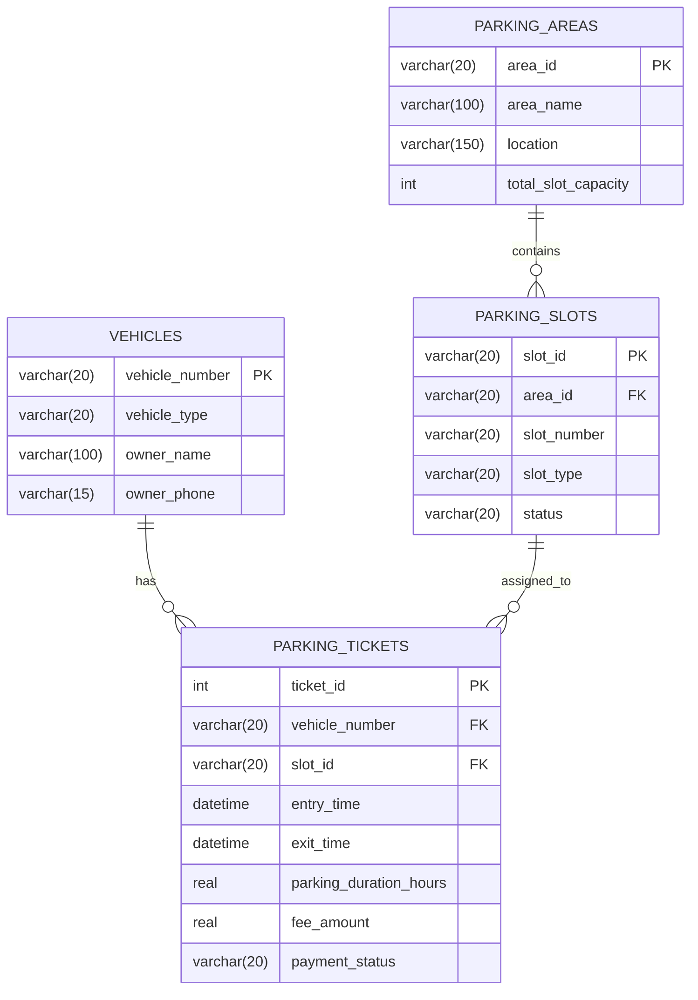

# 🗄️ Database Tables Specification & Live Dataset
## Smart Parking Management and Usage Analysis System (Scenario 24)

[]()
[]()
[]()

### 👤 Student Information
* **Student Name**: **Madhan sree**
* **Roll Number**: **732925ITR054**
* **Register Number**: **54**
* **Class**: **25IT3A**
* **Department**: Department of Information Technology
* **Institution**: Velalar College of Engineering and Technology (Autonomous), Erode – 638012
* **Course**: 25ITT31 – Database Management Systems (DBMS)

---

## 📌 Relational Database Overview
The database engine is **SQLite 3** (`database/parking_system.db`), fully normalized to **3NF / BCNF** with active foreign key referential integrity constraints (`PRAGMA foreign_keys = ON;`).



---

## 📋 Table 1: `parking_areas`
Stores designated parking zones across the campus/facility with slot capacities.

* **Primary Key**: `area_id`
* **Constraints**: `total_slot_capacity > 0`

| area_id | area_name | location | total_slot_capacity |
| :--- | :--- | :--- | :---: |
| **AREA-A** | North Wing Ground | Gate 1 - Ground Level Block A | 12 |
| **AREA-B** | South Deck Basement 1 | Gate 2 - Basement Ramp B | 10 |
| **AREA-C** | East Plaza Open Deck | Gate 3 - Surface Lot East | 10 |
| **AREA-D** | VIP & EV Charging Hub | Terminal Hub Central Concourse | 8 |

---

## 🅿️ Table 2: `parking_slots` (All 40 Slots)
Maintains slot inventory, vehicle classifications, and live availability statuses.

* **Primary Key**: `slot_id`
* **Foreign Key**: `area_id` → `parking_areas(area_id)` ON UPDATE CASCADE ON DELETE RESTRICT
* **Constraints**: `UNIQUE(area_id, slot_number)`
* **Allowed Types**: `TWO_WHEELER`, `FOUR_WHEELER`, `EV`, `HEAVY_VEHICLE`
* **Allowed Statuses**: `AVAILABLE`, `OCCUPIED`, `MAINTENANCE`

| slot_id | area_id | slot_number | slot_type | status |
| :--- | :--- | :--- | :--- | :--- |
| **A-TW-01** | AREA-A | TW-101 | TWO_WHEELER | 🔴 `OCCUPIED` |
| **A-TW-02** | AREA-A | TW-102 | TWO_WHEELER | 🔴 `OCCUPIED` |
| **A-TW-03** | AREA-A | TW-103 | TWO_WHEELER | 🟢 `AVAILABLE` |
| **A-TW-04** | AREA-A | TW-104 | TWO_WHEELER | 🟢 `AVAILABLE` |
| **A-FW-01** | AREA-A | FW-101 | FOUR_WHEELER | 🔴 `OCCUPIED` |
| **A-FW-02** | AREA-A | FW-102 | FOUR_WHEELER | 🔴 `OCCUPIED` |
| **A-FW-03** | AREA-A | FW-103 | FOUR_WHEELER | 🟢 `AVAILABLE` |
| **A-FW-04** | AREA-A | FW-104 | FOUR_WHEELER | 🟢 `AVAILABLE` |
| **A-FW-05** | AREA-A | FW-105 | FOUR_WHEELER | 🟢 `AVAILABLE` |
| **A-FW-06** | AREA-A | FW-106 | FOUR_WHEELER | 🟢 `AVAILABLE` |
| **A-HV-01** | AREA-A | HV-101 | HEAVY_VEHICLE | 🔴 `OCCUPIED` |
| **A-HV-02** | AREA-A | HV-102 | HEAVY_VEHICLE | 🟢 `AVAILABLE` |
| **B-FW-01** | AREA-B | FW-201 | FOUR_WHEELER | 🔴 `OCCUPIED` |
| **B-FW-02** | AREA-B | FW-202 | FOUR_WHEELER | 🔴 `OCCUPIED` |
| **B-FW-03** | AREA-B | FW-203 | FOUR_WHEELER | 🟢 `AVAILABLE` |
| **B-FW-04** | AREA-B | FW-204 | FOUR_WHEELER | 🟢 `AVAILABLE` |
| **B-FW-05** | AREA-B | FW-205 | FOUR_WHEELER | 🟢 `AVAILABLE` |
| **B-TW-01** | AREA-B | TW-201 | TWO_WHEELER | 🟢 `AVAILABLE` |
| **B-TW-02** | AREA-B | TW-202 | TWO_WHEELER | 🟢 `AVAILABLE` |
| **B-TW-03** | AREA-B | TW-203 | TWO_WHEELER | 🟢 `AVAILABLE` |
| **B-TW-04** | AREA-B | TW-204 | TWO_WHEELER | 🟢 `AVAILABLE` |
| **B-TW-05** | AREA-B | TW-205 | TWO_WHEELER | 🟠 `MAINTENANCE` |
| **C-FW-01** | AREA-C | FW-301 | FOUR_WHEELER | 🟢 `AVAILABLE` |
| **C-FW-02** | AREA-C | FW-302 | FOUR_WHEELER | 🟢 `AVAILABLE` |
| **C-FW-03** | AREA-C | FW-303 | FOUR_WHEELER | 🔴 `OCCUPIED` |
| **C-FW-04** | AREA-C | FW-304 | FOUR_WHEELER | 🟢 `AVAILABLE` |
| **C-FW-05** | AREA-C | FW-305 | FOUR_WHEELER | 🟢 `AVAILABLE` |
| **C-HV-01** | AREA-C | HV-301 | HEAVY_VEHICLE | 🟢 `AVAILABLE` |
| **C-HV-02** | AREA-C | HV-302 | HEAVY_VEHICLE | 🟢 `AVAILABLE` |
| **C-HV-03** | AREA-C | HV-303 | HEAVY_VEHICLE | 🟢 `AVAILABLE` |
| **C-TW-01** | AREA-C | TW-301 | TWO_WHEELER | 🟢 `AVAILABLE` |
| **C-TW-02** | AREA-C | TW-302 | TWO_WHEELER | 🟢 `AVAILABLE` |
| **D-EV-01** | AREA-D | EV-401 | EV | 🔴 `OCCUPIED` |
| **D-EV-02** | AREA-D | EV-402 | EV | 🔴 `OCCUPIED` |
| **D-EV-03** | AREA-D | EV-403 | EV | 🟢 `AVAILABLE` |
| **D-EV-04** | AREA-D | EV-404 | EV | 🟢 `AVAILABLE` |
| **D-FW-01** | AREA-D | FW-401 | FOUR_WHEELER | 🟢 `AVAILABLE` |
| **D-FW-02** | AREA-D | FW-402 | FOUR_WHEELER | 🟢 `AVAILABLE` |
| **D-FW-03** | AREA-D | FW-403 | FOUR_WHEELER | 🟢 `AVAILABLE` |
| **D-FW-04** | AREA-D | FW-404 | FOUR_WHEELER | 🟢 `AVAILABLE` |

---

## 🚗 Table 3: `vehicles` (30 Registered Vehicles)
Stores registered vehicle records and verified owner contact credentials.

* **Primary Key**: `vehicle_number`
* **Allowed Types**: `TWO_WHEELER`, `FOUR_WHEELER`, `EV`, `HEAVY_VEHICLE`

| vehicle_number | vehicle_type | owner_name | owner_phone |
| :--- | :--- | :--- | :--- |
| **TN-33-AB-1001** | TWO_WHEELER | Karthik Raja | 9842111001 |
| **TN-33-BC-2002** | TWO_WHEELER | Suresh Kumar | 9842111002 |
| **TN-33-CD-3003** | TWO_WHEELER | Priya Dharshini | 9842111003 |
| **TN-33-DE-4004** | TWO_WHEELER | Aravind Swamy | 9842111004 |
| **TN-33-EF-5005** | TWO_WHEELER | Divya Bharathi | 9842111005 |
| **TN-33-FG-6006** | FOUR_WHEELER | Madhan sree | 9842111054 |
| **TN-33-GH-7007** | FOUR_WHEELER | Venkatesh S | 9842111007 |
| **TN-33-HJ-8008** | FOUR_WHEELER | Naveen Prashanth | 9842111008 |
| **TN-33-JK-9009** | FOUR_WHEELER | Deepak Nathan | 9842111009 |
| **TN-33-KL-1010** | FOUR_WHEELER | Anitha Devi | 9842111010 |
| **TN-33-LM-1111** | FOUR_WHEELER | Rajesh K | 9842111011 |
| **TN-33-MN-1212** | FOUR_WHEELER | Meenakshi Sundaram | 9842111012 |
| **TN-33-NP-1313** | FOUR_WHEELER | Gokul Kannan | 9842111013 |
| **TN-33-PR-1414** | FOUR_WHEELER | Shalini Mohan | 9842111014 |
| **TN-33-RS-1515** | FOUR_WHEELER | Vigneshwaran P | 9842111015 |
| **TN-33-ST-1616** | EV | Arunachalam M | 9842111016 |
| **TN-33-TU-1717** | EV | Lavanya Ramesh | 9842111017 |
| **TN-33-UV-1818** | EV | Sanjay Dutt | 9842111018 |
| **TN-33-VW-1919** | EV | Pooja Hegde | 9842111019 |
| **TN-33-WX-2020** | HEAVY_VEHICLE | GreenLine Logistics | 9842111020 |
| **TN-33-XY-2121** | HEAVY_VEHICLE | SRS Tours & Travels | 9842111021 |
| **TN-33-YZ-2222** | HEAVY_VEHICLE | Erode Express Movers | 9842111022 |
| **TN-38-AA-3131** | FOUR_WHEELER | Chandran B | 9842111023 |
| **TN-38-BB-3232** | TWO_WHEELER | Mohan Raj | 9842111024 |
| **TN-38-CC-3333** | EV | Kavitha S | 9842111025 |
| **TN-40-DD-4141** | FOUR_WHEELER | Senthil Nathan | 9842111026 |
| **TN-40-EE-4242** | FOUR_WHEELER | Manikandan V | 9842111027 |
| **TN-40-FF-4343** | TWO_WHEELER | Balaji Krishnan | 9842111028 |
| **TN-40-GG-4444** | FOUR_WHEELER | Subhashree R | 9842111029 |
| **TN-40-HH-4545** | HEAVY_VEHICLE | Royal Cargo Carrier | 9842111030 |

---

## 🎫 Table 4: `parking_tickets`

### Part A: Currently Parked Vehicles (Active Tickets: `payment_status = 'PENDING'`)
These 10 records represent active vehicles in the parking lot whose exit time has not arrived yet (`exit_time IS NULL`).

| ticket_id | vehicle_number | slot_id | entry_time | exit_time | duration (hrs) | fee_amount | payment_status |
| :---: | :--- | :--- | :--- | :---: | :---: | :---: | :--- |
| **1033** | TN-33-AB-1001 | A-TW-01 | 2026-11-18 08:30:00 | *In Session* | 0.00 | ₹0.00 | 🟡 `PENDING` |
| **1034** | TN-33-BC-2002 | A-TW-02 | 2026-11-18 08:45:00 | *In Session* | 0.00 | ₹0.00 | 🟡 `PENDING` |
| **1035** | TN-33-FG-6006 | A-FW-01 | 2026-11-18 09:00:00 | *In Session* | 0.00 | ₹0.00 | 🟡 `PENDING` |
| **1036** | TN-33-GH-7007 | A-FW-02 | 2026-11-18 09:15:00 | *In Session* | 0.00 | ₹0.00 | 🟡 `PENDING` |
| **1037** | TN-33-WX-2020 | A-HV-01 | 2026-11-18 09:30:00 | *In Session* | 0.00 | ₹0.00 | 🟡 `PENDING` |
| **1038** | TN-33-HJ-8008 | B-FW-01 | 2026-11-18 09:45:00 | *In Session* | 0.00 | ₹0.00 | 🟡 `PENDING` |
| **1039** | TN-33-JK-9009 | B-FW-02 | 2026-11-18 10:00:00 | *In Session* | 0.00 | ₹0.00 | 🟡 `PENDING` |
| **1040** | TN-40-DD-4141 | C-FW-03 | 2026-11-18 10:10:00 | *In Session* | 0.00 | ₹0.00 | 🟡 `PENDING` |
| **1041** | TN-33-ST-1616 | D-EV-01 | 2026-11-18 10:15:00 | *In Session* | 0.00 | ₹0.00 | 🟡 `PENDING` |
| **1042** | TN-33-TU-1717 | D-EV-02 | 2026-11-18 10:20:00 | *In Session* | 0.00 | ₹0.00 | 🟡 `PENDING` |

---

### Part B: Sample Completed Tickets (Historical Settled Records)

| ticket_id | vehicle_number | slot_id | entry_time | exit_time | duration (hrs) | fee_amount | payment_status |
| :---: | :--- | :--- | :--- | :--- | :---: | :---: | :--- |
| **1001** | TN-33-AB-1001 | A-TW-01 | 2026-11-15 08:15:00 | 2026-11-15 10:45:00 | 2.50 | ₹25.00 | 🟢 `PAID` |
| **1002** | TN-33-FG-6006 | A-FW-01 | 2026-11-15 08:30:00 | 2026-11-15 12:30:00 | 4.00 | ₹80.00 | 🟢 `PAID` |
| **1003** | TN-33-ST-1616 | D-EV-01 | 2026-11-15 08:45:00 | 2026-11-15 11:15:00 | 2.50 | ₹62.50 | 🟢 `PAID` |
| **1004** | TN-33-BC-2002 | B-TW-01 | 2026-11-15 09:00:00 | 2026-11-15 13:00:00 | 4.00 | ₹40.00 | 🟢 `PAID` |
| **1005** | TN-33-GH-7007 | B-FW-01 | 2026-11-15 09:15:00 | 2026-11-15 14:15:00 | 5.00 | ₹100.00 | 🟢 `PAID` |
| **1006** | TN-33-WX-2020 | A-HV-01 | 2026-11-15 09:30:00 | 2026-11-15 15:30:00 | 6.00 | ₹240.00 | 🟢 `PAID` |
| **1007** | TN-38-AA-3131 | C-FW-01 | 2026-11-15 09:45:00 | 2026-11-15 11:45:00 | 2.00 | ₹40.00 | 🟢 `PAID` |
| **1008** | TN-33-CD-3003 | A-TW-02 | 2026-11-15 11:00:00 | 2026-11-15 12:30:00 | 1.50 | ₹20.00 | 🟢 `PAID` |
| **1009** | TN-33-HJ-8008 | A-FW-02 | 2026-11-15 11:30:00 | 2026-11-15 14:00:00 | 2.50 | ₹50.00 | 🟢 `PAID` |
| **1010** | TN-33-TU-1717 | D-EV-02 | 2026-11-15 12:00:00 | 2026-11-15 15:00:00 | 3.00 | ₹75.00 | 🟢 `PAID` |
| **1011** | TN-38-BB-3232 | B-TW-02 | 2026-11-15 12:15:00 | 2026-11-15 13:45:00 | 1.50 | ₹20.00 | 🟢 `PAID` |
| **1012** | TN-33-JK-9009 | C-FW-02 | 2026-11-15 12:45:00 | 2026-11-15 16:15:00 | 3.50 | ₹70.00 | 🟢 `PAID` |
| **1013** | TN-33-XY-2121 | C-HV-01 | 2026-11-15 14:00:00 | 2026-11-15 18:00:00 | 4.00 | ₹160.00 | 🟢 `PAID` |
| **1014** | TN-33-KL-1010 | B-FW-02 | 2026-11-15 14:30:00 | 2026-11-15 17:00:00 | 2.50 | ₹50.00 | 🟢 `PAID` |
| **1015** | TN-33-DE-4004 | A-TW-03 | 2026-11-15 15:00:00 | 2026-11-15 16:30:00 | 1.50 | ₹20.00 | 🟢 `PAID` |
| **1026** | TN-33-AB-1001 | A-TW-01 | 2026-11-16 08:30:00 | 2026-11-16 11:30:00 | 3.00 | ₹30.00 | 🟢 `PAID` |
| **1027** | TN-33-FG-6006 | A-FW-01 | 2026-11-16 09:00:00 | 2026-11-16 14:00:00 | 5.00 | ₹100.00 | 🟢 `PAID` |
| **1028** | TN-33-ST-1616 | D-EV-01 | 2026-11-16 09:30:00 | 2026-11-16 13:30:00 | 4.00 | ₹100.00 | 🟢 `PAID` |
| **1029** | TN-33-YZ-2222 | C-HV-02 | 2026-11-16 10:00:00 | 2026-11-16 17:00:00 | 7.00 | ₹280.00 | 🟢 `PAID` |
| **1032** | TN-40-HH-4545 | A-HV-01 | 2026-11-16 18:00:00 | 2026-11-16 22:00:00 | 4.00 | ₹160.00 | 🟢 `PAID` |

---

## 📊 Database Views Output (Virtual Analytical Tables)

### View 1: `v_slot_occupancy_summary`
Aggregates real-time slot statuses by area.
```sql
CREATE VIEW v_slot_occupancy_summary AS
SELECT 
    a.area_id,
    a.area_name,
    a.location,
    a.total_slot_capacity,
    COUNT(s.slot_id) AS total_configured_slots,
    SUM(CASE WHEN s.status = 'AVAILABLE' THEN 1 ELSE 0 END) AS available_slots,
    SUM(CASE WHEN s.status = 'OCCUPIED' THEN 1 ELSE 0 END) AS occupied_slots,
    SUM(CASE WHEN s.status = 'MAINTENANCE' THEN 1 ELSE 0 END) AS maintenance_slots,
    ROUND((CAST(SUM(CASE WHEN s.status = 'OCCUPIED' THEN 1 ELSE 0 END) AS REAL) / COUNT(s.slot_id)) * 100.0, 2) AS occupancy_rate_pct
FROM parking_areas a
LEFT JOIN parking_slots s ON a.area_id = s.area_id
GROUP BY a.area_id, a.area_name, a.location, a.total_slot_capacity;
```

**Output:**
| area_id | area_name | total_slots | available | occupied | maintenance | occupancy % |
| :--- | :--- | :---: | :---: | :---: | :---: | :---: |
| **AREA-A** | North Wing Ground | 12 | 7 | 5 | 0 | 41.67% |
| **AREA-B** | South Deck Basement 1 | 10 | 7 | 2 | 1 | 20.00% |
| **AREA-C** | East Plaza Open Deck | 10 | 9 | 1 | 0 | 10.00% |
| **AREA-D** | VIP & EV Charging Hub | 8 | 6 | 2 | 0 | 25.00% |

---

### View 2: `v_revenue_by_vehicle_type`
Computes financial performance by vehicular category.
```sql
CREATE VIEW v_revenue_by_vehicle_type AS
SELECT 
    v.vehicle_type,
    COUNT(t.ticket_id) AS total_settled_tickets,
    ROUND(SUM(t.parking_duration_hours), 2) AS total_hours_parked,
    ROUND(AVG(t.parking_duration_hours), 2) AS avg_duration_hours,
    ROUND(SUM(t.fee_amount), 2) AS total_revenue_inr,
    ROUND(AVG(t.fee_amount), 2) AS avg_ticket_fee_inr
FROM parking_tickets t
JOIN vehicles v ON t.vehicle_number = v.vehicle_number
WHERE t.payment_status = 'PAID'
GROUP BY v.vehicle_type;
```

**Output:**
| vehicle_type | settled_tickets | total_hours | avg_duration | total_revenue | avg_fee |
| :--- | :---: | :---: | :---: | :---: | :---: |
| **FOUR_WHEELER** | 15 | 47.50 hrs | 3.17 hrs | ₹1,030.00 | ₹68.67 |
| **HEAVY_VEHICLE** | 4 | 21.00 hrs | 5.25 hrs | ₹840.00 | ₹210.00 |
| **EV** | 5 | 13.50 hrs | 2.70 hrs | ₹362.50 | ₹72.50 |
| **TWO_WHEELER** | 8 | 18.00 hrs | 2.25 hrs | ₹200.00 | ₹25.00 |

---

## 💡 How to Execute SQL Scripts in Windows PowerShell

> [!NOTE]
> In PowerShell, the `<` operator is reserved and cannot be used for redirection. Use the pipeline syntax instead:

### Correct PowerShell Commands:
```powershell
cd "D:\project 2\database"

# In PowerShell, use Get-Content (or gc) with a pipe:
Get-Content schema.sql | sqlite3 parking_system.db
Get-Content seed_data.sql | sqlite3 parking_system.db

# Or run interactively inside SQLite:
sqlite3 parking_system.db
.read schema.sql
.read seed_data.sql
.tables
SELECT * FROM parking_areas;
.exit
```
