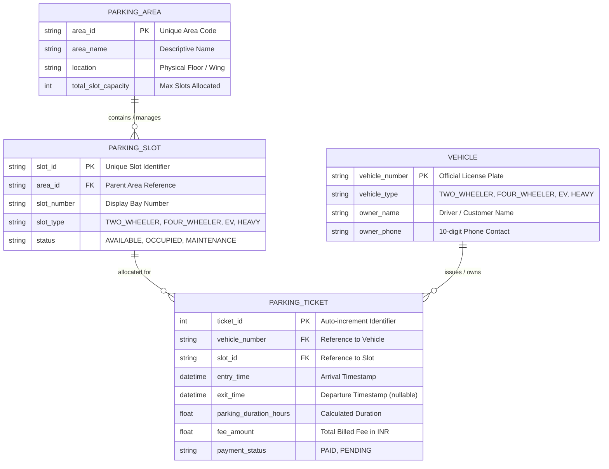

# Database Design and Normalization Documentation
## Smart Parking Management and Parking Usage Analysis System

---

### Project Information
* **Institution**: Velalar College of Engineering and Technology, Erode - 12
* **Department**: Department of Information Technology
* **Academic Year**: 2026 - 2027 (ODD Semester)
* **Class**: 25IT3A
* **Course Code & Title**: 25ITT31 - Database Management Systems
* **Student Name**: Madhan sree
* **Register Number**: 54
* **Roll Number**: 732925ITR054

---

## 1. Overview
The database layer for the Smart Parking Management System serves as the foundation for both real-time operational transactions (OLTP) and analytical processing (OLAP). This document specifies the conceptual Entity-Relationship (ER) model, the relational schema, step-by-step mathematical normalization (from UNF up to BCNF), indexing strategies, and transaction management protocols adhering strictly to the **25ITT31 DBMS** course curriculum.

---

## 2. Entity-Relationship (ER) Diagram

### 2.1 Conceptual ER Diagram (Mermaid)


### 2.2 Cardinality & Participation Constraints
1. **PARKING_AREA to PARKING_SLOT**:
   * Cardinality: **1 : N** (One parking area contains many parking slots; each slot belongs to exactly one parking area).
   * Participation: Total on `PARKING_SLOT` (a slot cannot exist without an area).
2. **PARKING_SLOT to PARKING_TICKET**:
   * Cardinality: **1 : N** (One parking slot can be associated with multiple historical parking tickets over time; each ticket references exactly one slot).
   * Participation: Total on `PARKING_TICKET` (a ticket must reference an assigned slot).
3. **VEHICLE to PARKING_TICKET**:
   * Cardinality: **1 : N** (One vehicle can have multiple parking visits and tickets over time; each ticket belongs to exactly one vehicle).
   * Participation: Total on `PARKING_TICKET` (every ticket must be tied to a registered vehicle).

---

## 3. Relational Data Model (Database Schema)

The conceptual entities are mapped to relational tables with explicit domain types and constraints:

### Table 1: `parking_areas`
* **Purpose**: Stores designated parking zones and overall capacities.
* **Schema**:
  $$\text{parking\_areas}(\underline{\text{area\_id}}, \text{area\_name}, \text{location}, \text{total\_slot\_capacity})$$
* **Constraints**:
  * `area_id`: Primary Key, VARCHAR(20) NOT NULL.
  * `area_name`: VARCHAR(100) NOT NULL.
  * `location`: VARCHAR(150) NOT NULL.
  * `total_slot_capacity`: INTEGER NOT NULL, CHECK (`total_slot_capacity` > 0).

### Table 2: `parking_slots`
* **Purpose**: Stores individual physical parking bays and current occupancy states.
* **Schema**:
  $$\text{parking\_slots}(\underline{\text{slot\_id}}, \text{area\_id}, \text{slot\_number}, \text{slot\_type}, \text{status})$$
* **Constraints**:
  * `slot_id`: Primary Key, VARCHAR(20) NOT NULL.
  * `area_id`: Foreign Key referencing `parking_areas(area_id)` ON UPDATE CASCADE ON DELETE RESTRICT.
  * `slot_number`: VARCHAR(20) NOT NULL.
  * `slot_type`: VARCHAR(20) NOT NULL, CHECK (`slot_type` IN ('TWO_WHEELER', 'FOUR_WHEELER', 'EV', 'HEAVY_VEHICLE')).
  * `status`: VARCHAR(20) NOT NULL DEFAULT 'AVAILABLE', CHECK (`status` IN ('AVAILABLE', 'OCCUPIED', 'MAINTENANCE')).
  * Unique Constraint: UNIQUE (`area_id`, `slot_number`).

### Table 3: `vehicles`
* **Purpose**: Stores vehicle registry records and owner details.
* **Schema**:
  $$\text{vehicles}(\underline{\text{vehicle\_number}}, \text{vehicle\_type}, \text{owner\_name}, \text{owner\_phone})$$
* **Constraints**:
  * `vehicle_number`: Primary Key, VARCHAR(20) NOT NULL.
  * `vehicle_type`: VARCHAR(20) NOT NULL, CHECK (`vehicle_type` IN ('TWO_WHEELER', 'FOUR_WHEELER', 'EV', 'HEAVY_VEHICLE')).
  * `owner_name`: VARCHAR(100) NOT NULL.
  * `owner_phone`: VARCHAR(15) NOT NULL.

### Table 4: `parking_tickets`
* **Purpose**: Logs transactional parking sessions, timestamps, durations, and financial fee collections.
* **Schema**:
  $$\text{parking\_tickets}(\underline{\text{ticket\_id}}, \text{vehicle\_number}, \text{slot\_id}, \text{entry\_time}, \text{exit\_time}, \text{parking\_duration\_hours}, \text{fee\_amount}, \text{payment\_status})$$
* **Constraints**:
  * `ticket_id`: Primary Key, INTEGER AUTOINCREMENT NOT NULL.
  * `vehicle_number`: Foreign Key referencing `vehicles(vehicle_number)` ON UPDATE CASCADE ON DELETE RESTRICT.
  * `slot_id`: Foreign Key referencing `parking_slots(slot_id)` ON UPDATE CASCADE ON DELETE RESTRICT.
  * `entry_time`: DATETIME NOT NULL.
  * `exit_time`: DATETIME NULL.
  * `parking_duration_hours`: REAL DEFAULT 0.0 CHECK (`parking_duration_hours` >= 0).
  * `fee_amount`: REAL DEFAULT 0.0 CHECK (`fee_amount` >= 0).
  * `payment_status`: VARCHAR(20) NOT NULL DEFAULT 'PENDING', CHECK (`payment_status` IN ('PENDING', 'PAID', 'CANCELLED')).

---

## 4. Database Normalization Analysis

Database normalization is the systematic process of organizing data to eliminate data redundancy and undesirable anomalies (insertion, deletion, and update anomalies).

### 4.1 Unnormalized Form (UNF)
Consider an unnormalized parking ledger sheet containing repeating multi-valued attributes:

$$\text{PARKING\_SYSTEM\_UNF}(\text{ticket\_id}, \text{vehicle\_number}, \text{vehicle\_type}, \text{owner\_name}, \text{owner\_phone}, \text{slot\_id}, \text{slot\_number}, \text{slot\_type}, \text{area\_id}, \text{area\_name}, \text{location}, \text{entry\_time}, \text{exit\_time}, \text{fee})$$

* **Anomalies in UNF**:
  * Repeating groups for vehicles with multiple parking visits.
  * Redundant area details duplicated on every single ticket.
  * Risk of deletion anomaly: deleting ticket records removes knowledge of the physical parking area.

---

### 4.2 First Normal Form (1NF)
> **Definition**: A relation is in 1NF if and only if all attribute values are atomic (indivisible) and there are no repeating groups or composite columns.

* **Transformation to 1NF**:
  * Every row has single atomic values for all attributes.
  * Composite candidate key chosen: $(\text{ticket\_id})$ or $(\text{vehicle\_number}, \text{entry\_time})$.
  * All multi-valued owner details or area entries are flattened.
* **Functional Dependencies (FDs) identified**:
  1. $FD_1: \text{ticket\_id} \rightarrow \text{vehicle\_number}, \text{slot\_id}, \text{entry\_time}, \text{exit\_time}, \text{parking\_duration\_hours}, \text{fee\_amount}, \text{payment\_status}$
  2. $FD_2: \text{vehicle\_number} \rightarrow \text{vehicle\_type}, \text{owner\_name}, \text{owner\_phone}$
  3. $FD_3: \text{slot\_id} \rightarrow \text{area\_id}, \text{slot\_number}, \text{slot\_type}, \text{status}$
  4. $FD_4: \text{area\_id} \rightarrow \text{area\_name}, \text{location}, \text{total\_slot\_capacity}$

---

### 4.3 Second Normal Form (2NF)
> **Definition**: A relation is in 2NF if it is in 1NF and every non-prime attribute is fully functionally dependent on the entire primary key (no partial functional dependency).

* **Check for Partial Dependencies**:
  * In the flattened single table with candidate key $(\text{ticket\_id})$, if we considered a composite key like $(\text{ticket\_id}, \text{vehicle\_number})$, the attribute $\text{owner\_name}$ would depend only on $\text{vehicle\_number}$ (a subset of the key), representing a partial dependency.
* **Decomposition to 2NF**:
  We decompose the monolithic table into relations based on determinants:
  1. $R_1(\underline{\text{ticket\_id}}, \text{vehicle\_number}, \text{slot\_id}, \text{entry\_time}, \text{exit\_time}, \text{parking\_duration\_hours}, \text{fee\_amount}, \text{payment\_status})$
  2. $R_2(\underline{\text{vehicle\_number}}, \text{vehicle\_type}, \text{owner\_name}, \text{owner\_phone})$
  3. $R_3(\underline{\text{slot\_id}}, \text{area\_id}, \text{slot\_number}, \text{slot\_type}, \text{status}, \text{area\_name}, \text{location}, \text{total\_slot\_capacity})$
* All partial dependencies are resolved.

---

### 4.4 Third Normal Form (3NF)
> **Definition**: A relation is in 3NF if it is in 2NF and there are no transitive functional dependencies (no non-prime attribute depends on another non-prime attribute via $X \rightarrow Y \rightarrow Z$).

* **Identification of Transitive Dependency in $R_3$**:
  * In $R_3$:
    * $\text{slot\_id} \rightarrow \text{area\_id}$
    * $\text{area\_id} \rightarrow \text{area\_name}, \text{location}, \text{total\_slot\_capacity}$
  * Here, $\text{area\_name}, \text{location}$, and $\text{total\_slot\_capacity}$ are transitively dependent on the primary key $\text{slot\_id}$ via $\text{area\_id}$.
  * If all slots in an area are deleted, the area itself is lost (deletion anomaly). Adding an area without slots is impossible (insertion anomaly).
* **Decomposition into 3NF**:
  We separate $R_3$ into two dedicated relations:
  * $\text{PARKING\_AREAS}(\underline{\text{area\_id}}, \text{area\_name}, \text{location}, \text{total\_slot\_capacity})$
  * $\text{PARKING\_SLOTS}(\underline{\text{slot\_id}}, \text{area\_id}, \text{slot\_number}, \text{slot\_type}, \text{status})$
* Now, in every relation $X \rightarrow Y$, $X$ is a superkey, or $Y$ is a prime attribute. The schema is in **3NF**.

---

### 4.5 Boyce-Codd Normal Form (BCNF)
> **Definition**: A relation is in BCNF if for every non-trivial functional dependency $X \rightarrow Y$, the determinant $X$ is a superkey.

Let us evaluate each resulting relation:
1. **`parking_areas`**:
   * Determinant: $\text{area\_id}$ is the primary key. $FD: \text{area\_id} \rightarrow \text{area\_name}, \text{location}, \text{total\_slot\_capacity}$. Since $\text{area\_id}$ is a superkey, this relation satisfies BCNF.
2. **`parking_slots`**:
   * Determinant: $\text{slot\_id}$ is the primary key. $FD: \text{slot\_id} \rightarrow \text{area\_id}, \text{slot\_number}, \text{slot\_type}, \text{status}$.
   * Alternate candidate key: $(\text{area\_id}, \text{slot\_number})$. The FD $(\text{area\_id}, \text{slot\_number}) \rightarrow \text{slot\_id}$ also has a superkey determinant. Hence, this relation satisfies BCNF.
3. **`vehicles`**:
   * Determinant: $\text{vehicle\_number}$ is the primary key. $FD: \text{vehicle\_number} \rightarrow \text{vehicle\_type}, \text{owner\_name}, \text{owner\_phone}$. Since $\text{vehicle\_number}$ is a superkey, this relation satisfies BCNF.
4. **`parking_tickets`**:
   * Determinant: $\text{ticket\_id}$ is the primary key. Every attribute is directly and uniquely determined by the ticket identifier. Hence, this relation satisfies BCNF.

**Conclusion**: The final relational database design is strictly in **Boyce-Codd Normal Form (BCNF)**, guaranteeing zero redundancy, lossless decomposition, and complete preservation of functional dependencies.

---

## 5. Indexing & Query Optimization

To achieve sub-millisecond retrieval in real-time gate operations and rapid aggregation during analytical queries, secondary B-Tree indexes are created:

1. **`idx_slots_area_status`**:
   ```sql
   CREATE INDEX idx_slots_area_status ON parking_slots(slot_type, status);
   ```
   * *Optimization*: Accelerates the search for available slots of a specific vehicle type when an incoming vehicle arrives at the gate (`WHERE slot_type = ? AND status = 'AVAILABLE'`).
2. **`idx_tickets_vehicle`**:
   ```sql
   CREATE INDEX idx_tickets_vehicle ON parking_tickets(vehicle_number, status);
   ```
   * *Optimization*: Enables rapid lookup of whether a vehicle is currently checked in, preventing double entries.
3. **`idx_tickets_entry_time`**:
   ```sql
   CREATE INDEX idx_tickets_entry_time ON parking_tickets(entry_time);
   ```
   * *Optimization*: Speeds up analytical time-series queries and peak-hour binning in Python.

---

## 6. Transaction Management & ACID Properties

In a multi-user or high-traffic parking facility, concurrent operations must guarantee **ACID** properties:

1. **Atomicity**: During vehicle check-in, two discrete operations occur: (a) mark slot as `OCCUPIED`, and (b) insert a new `parking_ticket`. Both operations are encapsulated inside a single database transaction (`BEGIN TRANSACTION` ... `COMMIT`). If an error occurs, `ROLLBACK` executes, ensuring no orphaned state.
2. **Consistency**: Database check constraints prevent illegal vehicle types or negative fee amounts. Foreign key enforcement prevents orphan tickets referencing deleted slots or non-existent vehicles.
3. **Isolation**: When an attendant checks in a vehicle, SQLite uses write-ahead logging (WAL) and row/table level locking to prevent two gates from assigning the same slot simultaneously.
4. **Durability**: Once a ticket or payment is recorded, WAL synchronization commits transactions to the persistent disk file `parking_system.db`.
