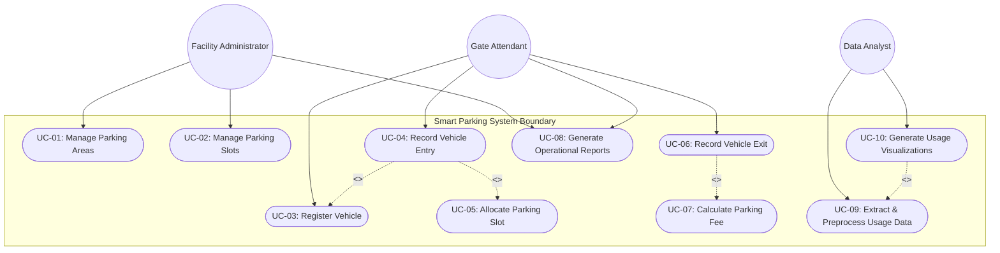
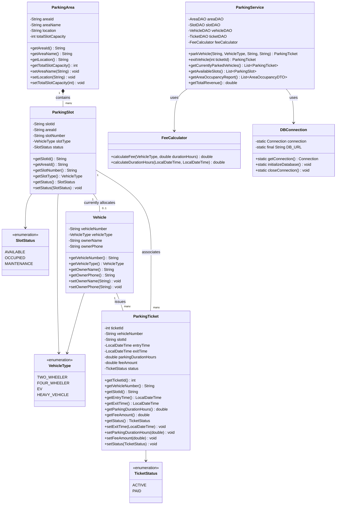
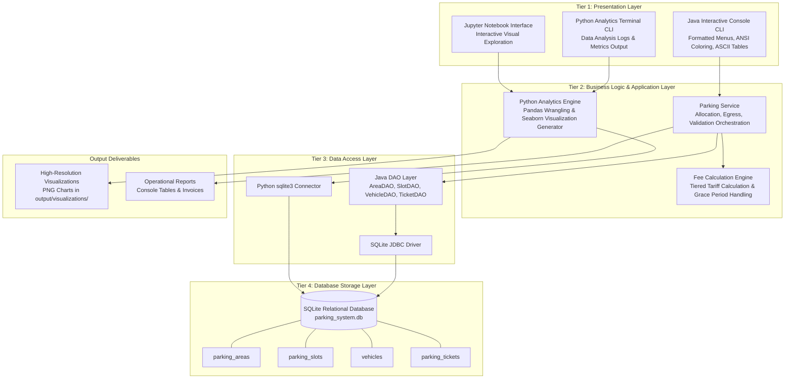
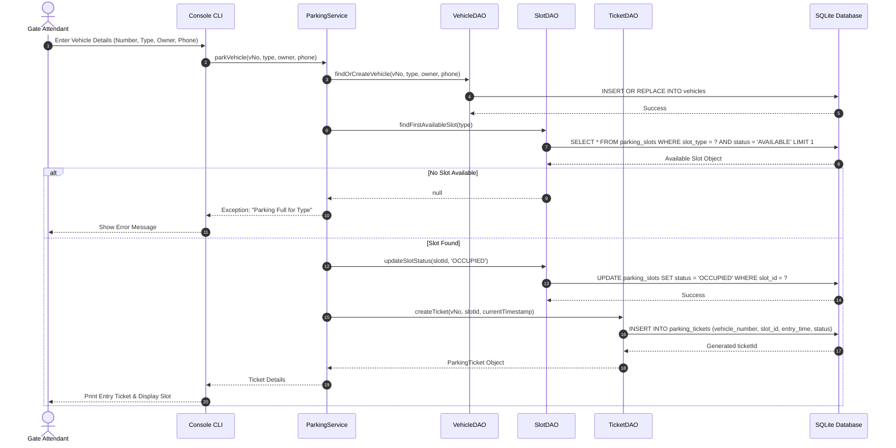
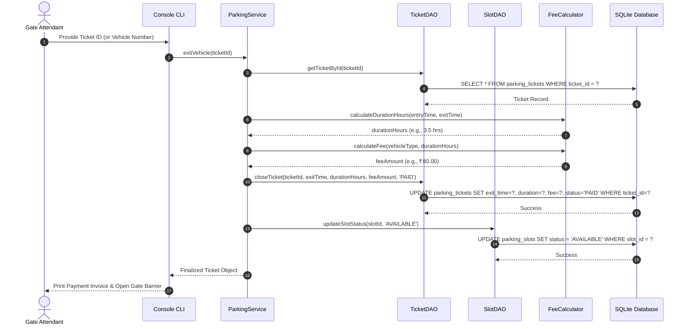
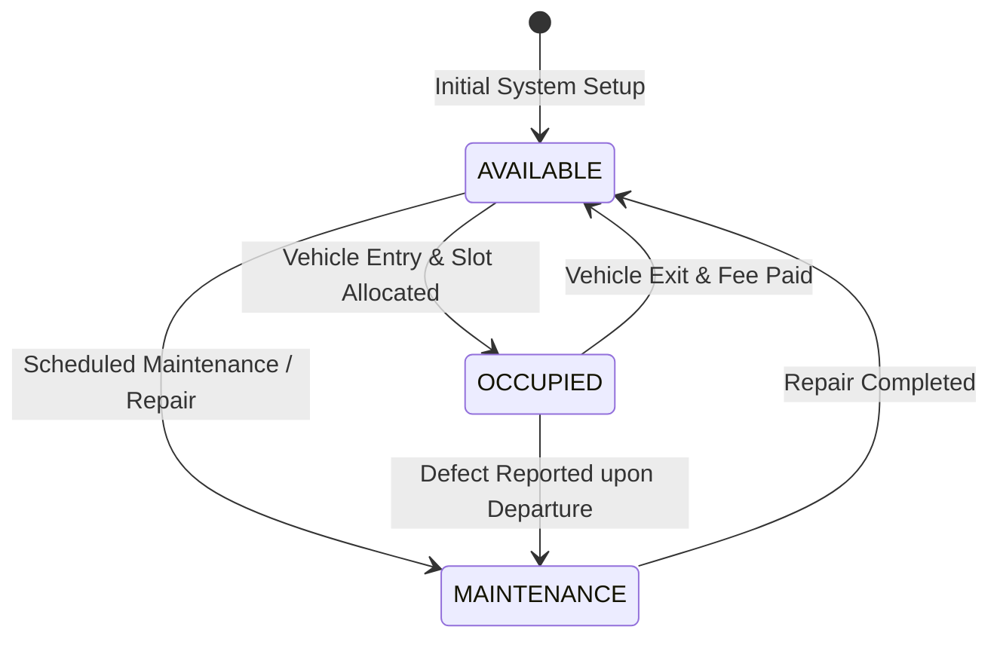
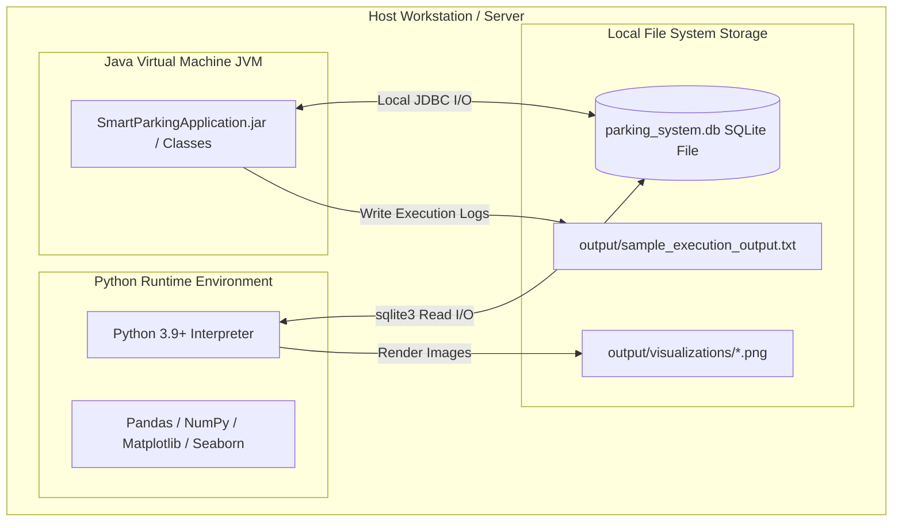

# System Design Diagrams and Architecture Document
## Smart Parking Management and Parking Usage Analysis System

---

### Project Information
* **Institution**: Velalar College of Engineering and Technology, Erode - 12
* **Department**: Department of Information Technology
* **Academic Year**: 2026 - 2027 (ODD Semester)
* **Class**: 25IT3A
* **Course Code & Title**: 25ITT33 - Software Engineering
* **Student Name**: Madhan sree
* **Register Number**: 54
* **Roll Number**: 732925ITR054

---

## 1. Overview
This document presents the structural, behavioral, and architectural models of the **Smart Parking Management and Parking Usage Analysis System**. The diagrams are modeled using the Unified Modeling Language (UML) standard and rendered via Mermaid for clear visualization and academic evaluation.

---

## 2. Use Case Diagram

### 2.1 UML Use Case Diagram


### 2.2 Use Case Specifications (Summary)
| Use Case ID | Name | Primary Actor | Pre-condition | Post-condition |
| :--- | :--- | :--- | :--- | :--- |
| **UC-01** | Manage Parking Areas | Administrator | System is initialized. | New area registered or updated in DB. |
| **UC-02** | Manage Parking Slots | Administrator | Target parking area exists. | Slot created with designated type. |
| **UC-03** | Register Vehicle | Attendant | Vehicle is physically at facility. | Vehicle details saved to DB. |
| **UC-04** | Record Vehicle Entry | Attendant | Incoming vehicle present. | Entry logged and ticket printed. |
| **UC-05** | Allocate Parking Slot | System / Attendant | Matching available slot exists. | Slot marked `OCCUPIED`. |
| **UC-06** | Record Vehicle Exit | Attendant | Vehicle is currently parked. | Exit timestamp logged, slot released. |
| **UC-07** | Calculate Parking Fee | System / Attendant | Vehicle exit recorded. | Fee calculated based on duration & category. |
| **UC-08** | Generate Operational Reports | Admin / Attendant | Database contains records. | Tabular reports rendered. |
| **UC-09** | Extract & Preprocess Data | Data Analyst | Database file accessible. | Pandas DataFrame cleaned & engineered. |
| **UC-10** | Generate Visualizations | Data Analyst | Preprocessed data available. | PNG charts rendered & saved. |

---

## 3. Class Diagram

### 3.1 Detailed UML Class Diagram


---

## 4. Overall System Architecture Diagram

The system adheres to a robust **Layered Enterprise Architecture** with decoupled transactional and analytical engines:



---

## 5. Sequence Diagrams

### 5.1 Vehicle Entry & Slot Allocation Sequence


### 5.2 Vehicle Exit, Fee Calculation & Slot Release Sequence


---

## 6. State Machine Diagram: Parking Slot Lifecycle



---

## 7. Component Diagram

```mermaid
graph LR
    subgraph Java Application Archive
        [Main Controller Component]
        [Service Logic Component]
        [Data Access Object Component]
        [Console Formatter Utility]
    end

    subgraph Data Tier
        [SQLite JDBC Engine]
        [(parking_system.db)]
    end

    subgraph Python Analytics Package
        [Data Extraction Module]
        [Pandas Data Wrangling Module]
        [Seaborn Visualization Generator]
    end

    [Main Controller Component] --> [Service Logic Component]
    [Service Logic Component] --> [Data Access Object Component]
    [Data Access Object Component] --> [SQLite JDBC Engine]
    [SQLite JDBC Engine] --> [(parking_system.db)]

    [Data Extraction Module] --> [(parking_system.db)]
    [Data Extraction Module] --> [Pandas Data Wrangling Module]
    [Pandas Data Wrangling Module] --> [Seaborn Visualization Generator]
```

---

## 8. Deployment Diagram


