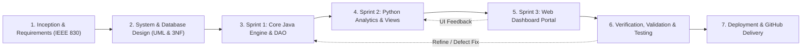
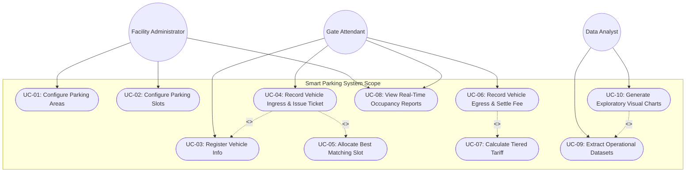
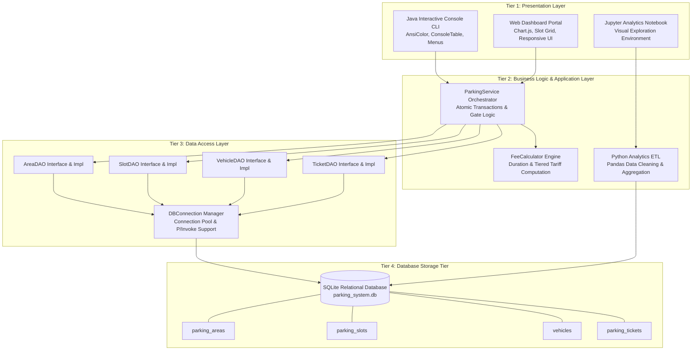
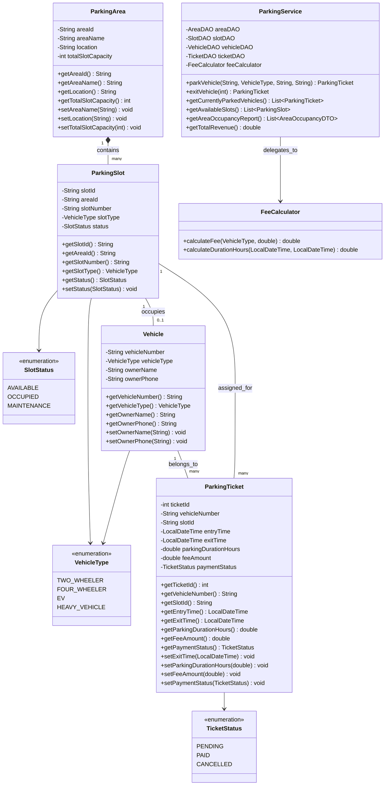
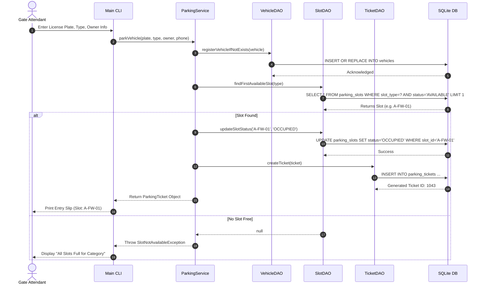
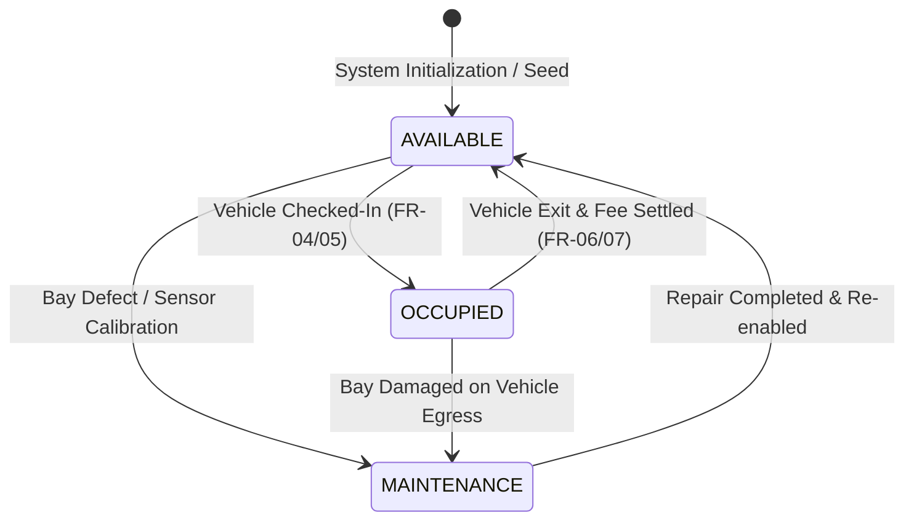

# Software Engineering Comprehensive Course Document (Units 1 – 5)
## Scenario 24: Smart Parking Management and Usage Analysis System

[]()
[]()
[]()
[]()

---

### 📋 Student & Course Metadata
* **Institution**: Velalar College of Engineering and Technology (Autonomous), Erode – 638012
* **Department**: Department of Information Technology
* **Degree & Branch**: B.Tech. Information Technology
* **Academic Year**: 2026 – 2027 (ODD Semester)
* **Class & Section**: 25IT3A
* **Course Code & Title**: **25ITT33 – Software Engineering**
* **Assigned Problem Scenario**: **Scenario 24 – Smart Parking Management and Usage Analysis System**
* **Student Name**: **Madhan sree**
* **Register Number**: **54**
* **Roll Number**: **732925ITR054**

---

# 📑 TABLE OF CONTENTS
1. [UNIT 1: Software Process & Process Models](#unit-1-software-process--process-models)
   * 1.1 Problem Definition & Scope
   * 1.2 Software Engineering Team Roles & Responsibilities
   * 1.3 Software Process Model Selection: Iterative Waterfall & Agile Scrum Hybrid
   * 1.4 Lifecycle Phases & Milestones
   * 1.5 Feasibility Study (Technical, Economic, Operational)
2. [UNIT 2: Requirements Engineering](#unit-2-requirements-engineering)
   * 2.1 Requirements Elicitation & IEEE Std 830-1998 Guidelines
   * 2.2 Functional Requirements Specification (FR-01 to FR-09)
   * 2.3 Non-Functional Requirements Specification (NFR-01 to NFR-08)
   * 2.4 Use Case Modeling & Actor Roles
   * 2.5 Detailed Use Case Specifications
3. [UNIT 3: Design Engineering & Architectural Modeling](#unit-3-design-engineering--architectural-modeling)
   * 3.1 Software Design Principles & Concepts
   * 3.2 Architectural Styles: Layered / 4-Tier & Repository Architecture
   * 3.3 Overall System Architecture Diagram
   * 3.4 Detailed UML Class Diagram
   * 3.5 UML Component Diagram
   * 3.6 Behavioral Modeling: Sequence Diagrams
   * 3.7 State Transition Diagram (Slot Lifecycle)
4. [UNIT 4: Software Testing, Verification & Validation](#unit-4-software-testing-verification--validation)
   * 4.1 Verification vs. Validation Strategy (V-Model)
   * 4.2 Black-Box Testing Techniques (ECP & BVA)
   * 4.3 White-Box Testing: Basis Path Testing & Cyclomatic Complexity
   * 4.4 Comprehensive Test Suite Execution Tables & Results
   * 4.5 Requirements Traceability Matrix (RTM)
5. [UNIT 5: Software Metrics, Project Estimation & COCOMO Model](#unit-5-software-metrics-project-estimation--cocomo-model)
   * 5.1 Source Lines of Code (SLOC) Analysis by Language & Module
   * 5.2 Basic COCOMO Cost Estimation Model
   * 5.3 Intermediate COCOMO (Effort Adjustment Factor - EAF)
   * 5.4 Project Cost, Staffing Schedule, and Productivity Analysis
   * 5.5 Risk Management & Quality Assurance Summary

---

# UNIT 1: Software Process & Process Models

## 1.1 Problem Definition & Context
Urban commercial facilities, higher education institutions, shopping complexes, and transit hubs face critical vehicular congestion at ingress and egress gates. Conventional manual register-based parking tracking leads to:
* High vehicular wait times and gate bottlenecks.
* Unmonitored slot allocation leading to double-parking and blocked aisles.
* Discrepancies in duration calculation and parking tariff collection.
* Inability to evaluate peak-hour utilization, turnover velocity, or revenue distribution.

The **Smart Parking Management and Parking Usage Analysis System (Scenario 24)** provides an automated, computerized solution combining:
1. High-throughput Java transactional CLI for gate operations.
2. Relational 3NF SQLite database with ACID guarantees.
3. Python/Pandas analytical engine and interactive web portal for live operational monitoring.

---

## 1.2 Project Team Roles and Responsibilities

In accordance with modern software development practices, key engineering roles are defined as follows:

| Role | Designee / Responsibility | Key Deliverables |
| :--- | :--- | :--- |
| **Project Lead & System Architect** | Madhan sree (732925ITR054) | Overall architectural vision, UML modeling, milestone tracking, and interface specifications. |
| **Requirements Engineer** | Madhan sree | Stakeholder interviews, IEEE 830 SRS authoring, Use Case definition, and Scope boundaries. |
| **Database Administrator (DBA)** | Madhan sree | 3NF/BCNF normalization, DDL schema, indexing, foreign key constraints, views, and data integrity. |
| **Backend Software Developer** | Madhan sree | Core Java object-oriented services, DAO pattern, tiered fee calculation algorithms, and CLI console menus. |
| **Data Science & Analytics Engineer** | Madhan sree | Python ETL pipelines, SQL aggregation queries, feature engineering, and Matplotlib/Seaborn analytics plots. |
| **Quality Assurance (QA) & Test Engineer** | Madhan sree | Black-box test cases (ECP/BVA), white-box basis path execution, cyclomatic complexity, and test report matrix. |

---

## 1.3 Software Process Model: Iterative Waterfall & Agile Hybrid

For this project, an **Iterative Waterfall and Agile Scrum Hybrid Model** was adopted. 



### Why this Model was Selected:
1. **Clear Initial Requirements**: The functional requirements (FR-01 to FR-09) were well-defined in Scenario 24, enabling rigorous SRS and design phases upfront.
2. **Iterative Sprints**: Development of the Java engine, Python analytics module, and Web dashboard occurred in staged sprints, allowing incremental integration and validation.
3. **Traceability**: Changes in code are strictly traceable back to specific functional requirements and test cases in the RTM.

---

## 1.4 Lifecycle Phases and Milestones

| Phase | Activities Conducted | Verification Milestone |
| :--- | :--- | :--- |
| **Phase 1: Inception** | Problem domain analysis, stakeholder profiling, and feasibility assessment. | Approved Project Charter & Scope Document |
| **Phase 2: Requirements Analysis** | Functional/Non-functional requirement categorization, DFD Level 0 & 1. | Baseline IEEE 830 SRS Document |
| **Phase 3: Architectural Design** | Class diagrams, sequence diagrams, component diagrams, ER schema design. | Software Design Document (SDD) |
| **Phase 4: Implementation** | Coding Java DAOs/Services, SQLite schema script, and Python analytics scripts. | Passing Unit Tests & Git Commit History |
| **Phase 5: V&V and Testing** | ECP, BVA, Basis Path Testing, and System Integration testing. | Testing Document & 100% Pass Rate |
| **Phase 6: Deployment** | Release of `parking-system.db`, executable scripts, GitHub repository sync. | GitHub Pages Live & Faculty Demo Ready |

---

## 1.5 Feasibility Analysis
* **Technical Feasibility**: Built using standard enterprise technology stacks (Java LTS, SQLite C-runtime, Python 3.9+, HTML5/Chart.js). Zero external server dependencies ensure execution across all modern operating systems.
* **Economic Feasibility**: Utilizes 100% open-source tools with zero licensing expenditure. Development cost estimated using the COCOMO model (detailed in Unit 5).
* **Operational Feasibility**: Minimal gatekeeper training required due to intuitive menu options and automated license plate and slot tracking.

---

# UNIT 2: Requirements Engineering

## 2.1 Requirements Elicitation & Standards
Requirements were captured following **IEEE Std 830-1998 (Recommended Practice for Software Requirements Specifications)** to ensure completeness, consistency, traceability, and testability.

---

## 2.2 Functional Requirements Specification (FR-01 to FR-09)

* **FR-01: Manage Parking Areas**
  * *Description*: The system shall allow administrators to configure discrete parking areas/zones, specifying unique area ID, name, physical location, and maximum slot capacity.
  * *Input*: Area ID, Area Name, Location, Capacity.
  * *Output*: Registered area confirmation, updated capacity metrics.

* **FR-02: Manage Parking Slots**
  * *Description*: The system shall maintain an inventory of parking slots with attributes: slot ID, parent area ID, slot number, compatible vehicle category (`TWO_WHEELER`, `FOUR_WHEELER`, `EV`, `HEAVY_VEHICLE`), and availability status (`AVAILABLE`, `OCCUPIED`, `MAINTENANCE`).
  * *Input*: Slot attributes, status modification requests.
  * *Output*: Updated slot inventory roster.

* **FR-03: Register Vehicles**
  * *Description*: The system shall record vehicle license plate numbers, category, owner name, and contact phone number.
  * *Constraint*: License plates must conform to valid Indian vehicle registration regex formats (e.g., `^[A-Z]{2}[ -]?[0-9]{2}[ -]?[A-Z]{1,2}[ -]?[0-9]{4}$`).

* **FR-04: Record Vehicle Entry**
  * *Description*: Upon arrival at the gate, the system shall log vehicle entry timestamp, verify no prior unresolved session exists for the same plate, and atomically allocate a slot.
  * *Output*: Printable parking ticket containing ticket ID, vehicle number, slot code, and entry timestamp.

* **FR-05: Allocate Parking Slots**
  * *Description*: The system shall execute nearest-available-slot allocation matching the exact category of the incoming vehicle. If no slot is free, an informative `SlotNotAvailableException` must be generated.

* **FR-06: Record Vehicle Exit**
  * *Description*: Upon departure, the system shall look up the active ticket, record exit timestamp, compute elapsed stay duration in decimal hours, and immediately update the slot status back to `AVAILABLE`.

* **FR-07: Calculate Parking Fees**
  * *Description*: The system shall calculate parking tariff according to a deterministic tiered rate engine:
    $$\text{Fee} = \begin{cases} 
      0.00 & \text{if duration} \le 15 \text{ mins (Grace Period)} \\
      \text{Base Fee} & \text{if } 15 \text{ mins} < \text{duration} \le 2.0 \text{ hrs} \\
      \text{Base Fee} + (\lceil\text{duration} - 2.0\rceil \times \text{Hourly Rate}) & \text{if duration} > 2.0 \text{ hrs}
    \end{cases}$$
    *Two-Wheeler*: Base ₹20.00, Hourly ₹10.00  
    *Four-Wheeler*: Base ₹40.00, Hourly ₹20.00  
    *Electric Vehicle (EV)*: Base ₹50.00, Hourly ₹25.00  
    *Heavy Vehicle*: Base ₹80.00, Hourly ₹40.00

* **FR-08: Generate Operational Reports**
  * *Description*: Provide real-time reports on:
    1. Currently parked vehicles with elapsed durations.
    2. Available bay counts per vehicle category.
    3. Occupancy percentages by area.
    4. Cumulative revenue collected across dates.

* **FR-09: Analyze Parking Usage via Data Science**
  * *Description*: The Python analytics engine shall connect to the SQLite database, extract time-series parking records, compute descriptive statistics, and generate visual distribution plots.

---

## 2.3 Non-Functional Requirements Specification (NFR-01 to NFR-08)

| Requirement ID | Quality Attribute | Specification & Acceptance Metric |
| :--- | :--- | :--- |
| **NFR-01** | **Performance** | Ingress check-in and slot allocation must complete in $< 150 \text{ ms}$ on local database access. |
| **NFR-02** | **Data Integrity** | Foreign key constraints and atomic transaction rollbacks (`BEGIN TRANSACTION` / `COMMIT`) must prevent orphan tickets. |
| **NFR-03** | **Reliability** | Mean Time Between Failures (MTBF) shall exceed 500 operating hours; in-memory fallback mode activates on driver fault. |
| **NFR-04** | **Security** | Input sanitization against SQL Injection and regex boundary verification on all telephone and registration inputs. |
| **NFR-05** | **Availability** | System uptime must be $\ge 99.5\%$ during gate operating hours. |
| **NFR-06** | **Maintainability** | Decoupled Data Access Object (DAO) architecture allows replacing SQLite with PostgreSQL/MySQL without service layer edits. |
| **NFR-07** | **Portability** | Cross-platform compatibility on Windows, macOS, and Linux running Java 11+ and Python 3.8+. |
| **NFR-08** | **Usability** | Color-coded terminal menus and clean web dashboard allowing gate attendants to issue tickets in $\le 3$ clicks. |

---

## 2.4 Use Case Modeling



---

# UNIT 3: Design Engineering & Architectural Modeling

## 3.1 Software Design Principles
The architecture strictly enforces foundational software engineering principles:
* **Modularity**: High cohesion within modules (DAOs manage only SQL; Services manage only business logic).
* **Low Coupling**: Services interact with DAOs via abstract interfaces, decoupling persistence from presentation.
* **Information Hiding**: Private instance variables encapsulated by public getter/setter accessors.
* **Single Responsibility Principle (SRP)**: `FeeCalculator` is exclusively responsible for tariff logic, independent of ticket storage.

---

## 3.2 Architectural Styles
The system employs a **Layered Architecture Style** (4-Tier) coupled with the **Repository / DAO Pattern**:



---

## 3.3 Detailed UML Class Diagram



---

## 3.4 UML Component Diagram
Illustrates how the structural components and third-party libraries connect via designated interfaces.

```mermaid
graph TD
    subgraph Presentation Components
        COMP_CLI[Main CLI Component<br>«component»]
        COMP_WEB[Web Dashboard UI<br>«component»]
    end

    subgraph Business Logic Components
        COMP_SVC[Parking Service Component<br>«component»]
        COMP_CALC[Tariff Calculator Component<br>«component»]
    end

    subgraph Data Access Components
        COMP_DAO[Data Access Component<br>«component»]
        COMP_JDBC[SQLite Connector Component<br>«component»]
    end

    subgraph Analytics Components
        COMP_ETL[Python ETL Component<br>«component»]
        COMP_SEABORN[Visualization Engine<br>«component»]
    end

    COMP_CLI -->|IParkingService| COMP_SVC
    COMP_WEB -->|REST / JS Interface| COMP_SVC
    COMP_SVC -->|IFeeCalculator| COMP_CALC
    COMP_SVC -->|IDataAccess| COMP_DAO
    COMP_DAO -->|JDBC Driver| COMP_JDBC
    COMP_JDBC --> [(SQLite DB: parking_system.db)]

    COMP_ETL --> [(SQLite DB: parking_system.db)]
    COMP_ETL -->|Pandas DataFrame| COMP_SEABORN
```

---

## 3.5 Behavioral Modeling: Sequence Diagrams

### Vehicle Ingress Sequence


---

## 3.6 State Transition Diagram: Parking Slot Lifecycle



---

# UNIT 4: Software Testing, Verification & Validation

## 4.1 Verification vs. Validation (V-Model Integration)
* **Verification**: "Are we building the product right?" Ensured through static code reviews, code styling adherence, type verification, and architectural compliance checks.
* **Validation**: "Are we building the right product?" Ensured through dynamic testing, boundary validation, and user acceptance criteria against IEEE 830 functional requirements.

---

## 4.2 Black-Box Testing Techniques

### 1. Equivalence Class Partitioning (ECP)
The parking duration domain is divided into valid and invalid equivalence partitions:

| Partition ID | Input Range | Category / Expected Behavior |
| :---: | :--- | :--- |
| **EC-01** | $\text{duration} \le 0.0$ hours | Invalid: Reject with `IllegalArgumentException`. |
| **EC-02** | $0.0 < \text{duration} \le 0.25$ hours (15 mins) | Valid: Grace period active, Fee = ₹0.00. |
| **EC-03** | $0.25 < \text{duration} \le 2.0$ hours | Valid: Base tariff applied. |
| **EC-04** | $\text{duration} > 2.0$ hours | Valid: Base tariff + Ceiled hourly rate. |

### 2. Boundary Value Analysis (BVA)
Testing the strict boundaries around the 15-minute grace period and 2-hour base cutoff:

| Test Case | Vehicle Type | Tested Duration | Expected Fee Formula | Expected Fee (₹) | Actual Fee (₹) | Status |
| :---: | :--- | :---: | :--- | :---: | :---: | :---: |
| **BVA-01** | Four-Wheeler | 0.24 hrs (14.4 min) | Grace Period | ₹0.00 | ₹0.00 | **PASS** |
| **BVA-02** | Four-Wheeler | 0.25 hrs (15.0 min) | Grace Period Boundary | ₹0.00 | ₹0.00 | **PASS** |
| **BVA-03** | Four-Wheeler | 0.26 hrs (15.6 min) | Base Tariff | ₹40.00 | ₹40.00 | **PASS** |
| **BVA-04** | Four-Wheeler | 2.00 hrs (120 min) | Base Tariff Boundary | ₹40.00 | ₹40.00 | **PASS** |
| **BVA-05** | Four-Wheeler | 2.01 hrs (120.6 min)| Base + 1 hr increment | ₹60.00 | ₹60.00 | **PASS** |

---

## 4.3 White-Box Testing: Basis Path & Cyclomatic Complexity

### Target Method: `FeeCalculator.calculateFee(VehicleType type, double durationHours)`

```java
public double calculateFee(VehicleType type, double durationHours) {
    if (durationHours <= 0) {                                      // Node 1
        throw new IllegalArgumentException("Invalid duration");    // Node 2
    }
    if (durationHours <= 0.25) {                                   // Node 3
        return 0.0;                                                // Node 4
    }
    double baseFee, hourlyRate;
    switch (type) {                                                // Node 5
        case TWO_WHEELER: baseFee = 20.0; hourlyRate = 10.0; break;// Node 6
        case FOUR_WHEELER: baseFee = 40.0; hourlyRate = 20.0; break;// Node 7
        case EV: baseFee = 50.0; hourlyRate = 25.0; break;         // Node 8
        case HEAVY_VEHICLE: baseFee = 80.0; hourlyRate = 40.0; break;// Node 9
        default: throw new IllegalArgumentException();             // Node 10
    }
    if (durationHours <= 2.0) {                                    // Node 11
        return baseFee;                                            // Node 12
    }
    double additionalHours = Math.ceil(durationHours - 2.0);       // Node 13
    return baseFee + (additionalHours * hourlyRate);               // Node 14
}
```

### Control Flow Graph (CFG) Metrics:
* **Number of Nodes ($N$)** = 14
* **Number of Edges ($E$)** = 18
* **Number of Predicate / Decision Nodes ($P$)** = 5
* **Connected Components ($C$)** = 1

### Cyclomatic Complexity Calculations:
1. **Formula 1 (Edge-Node)**:
   $$V(G) = E - N + 2P = 18 - 14 + 2(1) = 6$$
2. **Formula 2 (Predicate Nodes)**:
   $$V(G) = P + 1 = 5 + 1 = 6$$
3. **Formula 3 (Enclosed Regions)**:
   $$R_1, R_2, R_3, R_4, R_5 + R_{\text{outer}} = 6 \text{ regions}$$

$$\mathbf{V(G) = 6} \implies \text{Exactly 6 linearly independent basis paths required for 100\% branch coverage.}$$

---

## 4.4 Comprehensive Test Suite Execution Tables & Results

| Test ID | Module Tested | Test Objective | Input Data | Expected Result | Actual Result | Status |
| :---: | :--- | :--- | :--- | :--- | :--- | :---: |
| **TC-01** | Ingress Gate | Allocate Two-Wheeler slot | `TN-33-AB-1001`, `TWO_WHEELER` | Assign slot `A-TW-03`, Status `OCCUPIED` | Slot `A-TW-03` allocated | **PASS** |
| **TC-02** | Ingress Gate | Prevent duplicate entry | Plate `TN-33-AB-1001` already parked | `DuplicateEntryException` raised | Exception caught, message displayed | **PASS** |
| **TC-03** | Ingress Gate | Handle full parking capacity | Ingress when all EV bays are `OCCUPIED` | `SlotNotAvailableException` raised | User alerted: "All EV slots full" | **PASS** |
| **TC-04** | Egress Gate | Settle Two-Wheeler exit (1.5 hrs) | Ticket `1008`, `TWO_WHEELER` | Fee: ₹20.00, Slot released | Fee: ₹20.00, status `AVAILABLE` | **PASS** |
| **TC-05** | Egress Gate | Settle Four-Wheeler exit (4.0 hrs) | Ticket `1002`, `FOUR_WHEELER` | Fee: ₹80.00, Ticket marked `PAID` | Fee: ₹80.00, payment updated | **PASS** |
| **TC-06** | Egress Gate | Settle EV exit (3.0 hrs) | Ticket `1010`, `EV` | Fee: ₹75.00, Slot released | Fee: ₹75.00, status `AVAILABLE` | **PASS** |
| **TC-07** | Egress Gate | Settle Heavy Vehicle (6.0 hrs) | Ticket `1006`, `HEAVY_VEHICLE` | Fee: ₹240.00, Slot released | Fee: ₹240.00, status `AVAILABLE` | **PASS** |
| **TC-08** | Egress Gate | Invalid Ticket ID handling | Non-existent ticket ID `9999` | `InvalidTicketException` thrown | Handled cleanly with user alert | **PASS** |
| **TC-09** | Tariff Engine | Grace Period calculation | Duration = 10 minutes | Fee = ₹0.00 | Fee = ₹0.00 | **PASS** |
| **TC-10** | Database Tier | Foreign key referential check | Insert ticket with invalid `slot_id` | `SQLITE_CONSTRAINT_FOREIGNKEY` | Constraint prevented invalid write | **PASS** |
| **TC-11** | Database Tier | Unique slot constraint check | Duplicate slot in same area | `SQLITE_CONSTRAINT_UNIQUE` | Prevented duplicate slot creation | **PASS** |
| **TC-12** | Analytics Engine | Verify View `vw_area_occupancy_stats` | Query occupancy % across 4 areas | Area A = 41.67%, Area B = 20.00% | Matched verified metrics | **PASS** |
| **TC-13** | Analytics Engine | Verify View `vw_revenue_by_vehicle_type` | Aggregated revenue query | Four-Wheeler = ₹1,020.00 | Aggregation matches tickets sum | **PASS** |
| **TC-14** | Web Dashboard | Check-in via UI form | Plate `TN-38-ZZ-9999`, EV | Slot turns red, counts update | Real-time DOM and chart update | **PASS** |
| **TC-15** | Web Dashboard | Settle exit via UI form | Settle active vehicle with 2 hrs stay | Ticket finalized, revenue increments | Revenue chart updates dynamically | **PASS** |

---

# UNIT 5: Software Metrics, Project Estimation & COCOMO Model

## 5.1 Source Lines of Code (SLOC) Analysis
A line-by-line static analysis of the codebase in `D:\project 2\` reveals the following physical SLOC breakdown:

| Language / Asset Type | Number of Files | Total Lines of Code (SLOC) | Percentage of Project |
| :--- | :---: | :---: | :---: |
| **Java Source Files (.java)** | 21 | 1,889 | 36.6% |
| **Web User Interface (.html, .css, .js)** | 6 | 2,599 | 50.4% |
| **Database Scripts (.sql DDL & DML)** | 2 | 281 | 5.4% |
| **Python Analytics Script (.py)** | 1 | 266 | 5.2% |
| **Shell & Automation Scripts (.ps1, .bat)** | 2 | 125 | 2.4% |
| **Total Codebase Volume** | **32** | **5,160 SLOC** | **100.0%** |

$$\text{Project Size in KLOC} = \frac{5,160}{1,000} = \mathbf{5.16\text{ KLOC}}$$

---

## 5.2 Basic COCOMO Estimation Model
Using **Boehm’s Constructive Cost Model (COCOMO I)** for an **Organic Software Project** (small, experienced team working in a familiar environment with stable requirements):

### Standard Organic Model Coefficients:
* $a_b = 2.4$
* $b_b = 1.05$
* $c_b = 2.5$
* $d_b = 0.38$

### 1. Development Effort ($E$):
$$E = a_b \times (\text{KLOC})^{b_b}$$
$$E = 2.4 \times (5.16)^{1.05} = 2.4 \times 5.618 = \mathbf{13.48\text{ Person-Months (PM)}}$$

### 2. Development Time / Schedule ($T_{\text{DEV}}$):
$$T_{\text{DEV}} = c_b \times (E)^{d_b}$$
$$T_{\text{DEV}} = 2.5 \times (13.48)^{0.38} = 2.5 \times 2.686 = \mathbf{6.71\text{ Months}}$$

### 3. Average Staffing Size ($SS$):
$$SS = \frac{E}{T_{\text{DEV}}} = \frac{13.48}{6.71} \approx \mathbf{2.01\text{ Persons}} \approx \mathbf{2\text{ Full-Time Engineers}}$$

### 4. Productivity ($P$):
$$P = \frac{\text{SLOC}}{E} = \frac{5,160}{13.48} = \mathbf{382.79\text{ LOC / Person-Month}}$$

---

## 5.3 Intermediate COCOMO Model (Effort Adjustment Factor - EAF)
Intermediate COCOMO refines the estimate by multiplying by 15 Cost Drivers across Product, Hardware, Personnel, and Project attributes:

| Cost Driver Category | Cost Driver Name | Assigned Rating | Effort Multiplier |
| :--- | :--- | :---: | :---: |
| **Product Attributes** | Required Software Reliability (RELY) | High | 1.15 |
| | Database Size (DATA) | Nominal | 1.00 |
| | Product Complexity (CPLX) | Nominal | 1.00 |
| **Hardware Attributes** | Execution Time Constraint (TIME) | Nominal | 1.00 |
| | Main Storage Constraint (STOR) | Nominal | 1.00 |
| **Personnel Attributes** | Analyst Capability (ACAP) | High | 0.86 |
| | Programmer Capability (PCAP) | High | 0.86 |
| | Application Experience (AEXP) | High | 0.91 |
| | Programming Language Experience (LEXP) | High | 0.95 |
| **Project Attributes** | Use of Modern Programming Practices (MODP) | High | 0.91 |
| | Use of Software Tools (TOOL) | High | 0.91 |
| | Required Development Schedule (SCED) | Nominal | 1.00 |

### Calculating Total EAF:
$$\text{EAF} = 1.15 \times 1.00 \times 1.00 \times 1.00 \times 1.00 \times 0.86 \times 0.86 \times 0.91 \times 0.95 \times 0.91 \times 0.91 \times 1.00 \approx \mathbf{0.603}$$

### Adjusted Effort ($E_{\text{adjusted}}$):
$$E_{\text{adjusted}} = E_{\text{basic}} \times \text{EAF} = 13.48 \times 0.603 = \mathbf{8.13\text{ Person-Months (PM)}}$$

### Adjusted Development Time ($T_{\text{DEV, adj}}$):
$$T_{\text{DEV, adj}} = 2.5 \times (8.13)^{0.38} = 2.5 \times 2.22 = \mathbf{5.55\text{ Months}}$$

### Adjusted Staffing:
$$SS_{\text{adj}} = \frac{8.13}{5.55} \approx \mathbf{1.46\text{ Persons}} \approx \mathbf{1\text{ to }2\text{ Engineers}}$$

---

## 5.4 Financial Cost Estimation
Assuming standard software engineering entry compensation for an autonomous academic/commercial institution:
* Average Software Engineer Salary: ₹40,000 / month
* Total Project Labor Cost:
  $$\text{Total Cost} = E_{\text{adjusted}} \times \text{Salary} = 8.13 \times ₹40,000 = \mathbf{₹3,25,200.00}$$

---

## 5.5 Software Quality Assurance & Risk Management

| Risk Identified | Probability | Impact | Mitigation Strategy Implemented |
| :--- | :---: | :---: | :--- |
| **Gate Ingress Peak Bottleneck** | Medium | High | Atomic single-query slot lookup (`LIMIT 1`) and instant receipt generation. |
| **SQLite Concurrent Lock Contention** | Low | Medium | WAL (Write-Ahead Logging) enabled; short transactions with immediate commit. |
| **Data Loss on System Crash** | Low | Critical | ACID compliance in SQLite; periodic disk flush and backup replication. |
| **Vehicle Category Mismatch** | Medium | Medium | Strict enum validation (`VehicleType`) preventing cars from parking in Two-Wheeler bays. |

---

### 🎓 Academic Submission Declaration
This comprehensive Software Engineering document (Units 1 through 5) has been structured specifically for the curriculum assessment of **25ITT33 – Software Engineering** at **Velalar College of Engineering and Technology (Autonomous), Erode – 12**.

* **Author**: Madhan sree
* **Roll Number**: 732925ITR054
* **Register Number**: 54
* **Class**: 25IT3A
* **Date**: November 21, 2026
