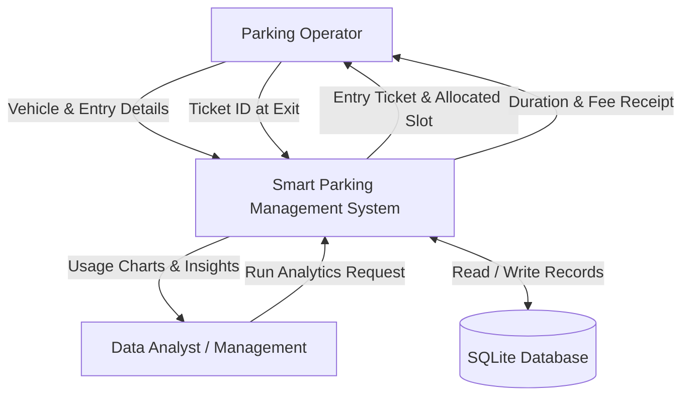
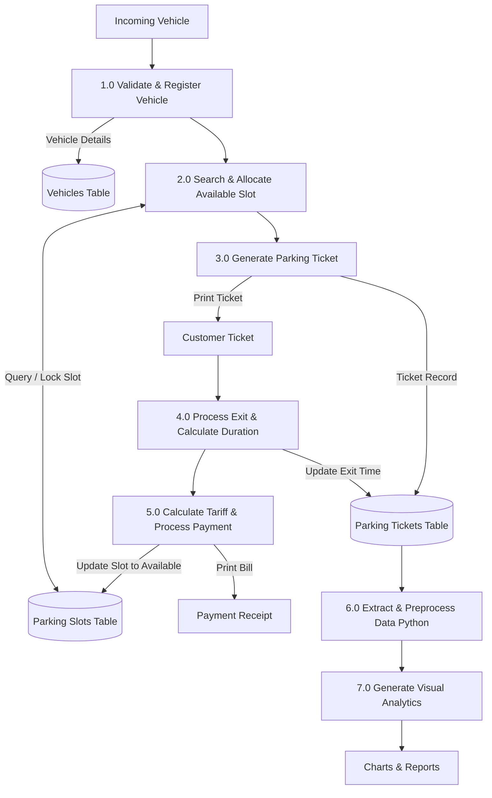

# Software Requirements Specification (SRS)
## Smart Parking Management and Parking Usage Analysis System

---

### Project Information
* **Institution**: Velalar College of Engineering and Technology (Autonomous), Erode - 638012
* **Department**: Department of Information Technology
* **Academic Year**: 2026 - 2027 (ODD Semester)
* **Class**: 25IT3A
* **Course Code & Title**: 25ITT33 - Software Engineering
* **Activity**: Project-Based Assessment
* **Assigned Scenario**: Scenario 24 - Smart Parking Management and Parking Usage Analysis System
* **Student Name**: Madhan sree
* **Register Number**: 54
* **Roll Number**: 732925ITR054

---

## 1. Introduction

### 1.1 Purpose
The purpose of this Software Requirements Specification (SRS) document is to provide a complete, formal description of the **Smart Parking Management and Parking Usage Analysis System**. It outlines the functional requirements, non-functional requirements, architectural characteristics, user interfaces, and constraints governing the design and implementation of the system. This document is written in accordance with IEEE Std 830-1998 recommendations and serves as the primary contract between the development team, end-users (parking operators/analysts), and academic evaluators.

### 1.2 Scope
Urban commercial centers, shopping malls, tertiary hospitals, educational institutions, IT tech parks, and multi-modal transit stations face severe parking congestion. Manual parking record-keeping leads to:
1. Slot allocation inefficiencies and accidental double-booking.
2. Inability to track real-time occupancy and empty slot distribution.
3. Long queues at entry and exit gates causing delays.
4. Human error and lack of transparency in fee computation.
5. Inability to identify peak parking hours, vehicle demographic shifts, and revenue trends.

The **Smart Parking Management and Parking Usage Analysis System** addresses these challenges by delivering an integrated, cross-disciplinary software solution:
* **Java Application (OOP & Business Logic)**: Manages real-time parking slot allocation, vehicle check-in/check-out lifecycle, automated fee calculation, and operational reporting.
* **Database Management System (SQLite / RDBMS)**: Provides an ACID-compliant relational data store with full 3NF/BCNF normalization, foreign key constraints, triggers, and optimized indexes.
* **Python Data Science & Analytics Module**: Extracts operational datasets from the database, conducts data preprocessing and wrangling (via Pandas/NumPy), and outputs exploratory data visualizations (via Matplotlib/Seaborn) to uncover parking patterns and peak utilization.

### 1.3 Definitions, Acronyms, and Abbreviations
* **SRS**: Software Requirements Specification
* **DBMS**: Database Management System
* **RDBMS**: Relational Database Management System
* **SQL**: Structured Query Language
* **ACID**: Atomicity, Consistency, Isolation, Durability
* **DAO**: Data Access Object design pattern
* **EDA**: Exploratory Data Analysis
* **EV**: Electric Vehicle
* **GUI / CLI**: Graphical User Interface / Command Line Interface
* **IEEE**: Institute of Electrical and Electronics Engineers
* **BCNF**: Boyce-Codd Normal Form

### 1.4 References
1. IEEE Std 830-1998: *IEEE Recommended Practice for Software Requirements Specifications*.
2. Pressman, R. S., & Maxim, B. R., *Software Engineering: A Practitioner's Approach*, 9th Edition, McGraw-Hill.
3. Silberschatz, A., Korth, H. F., & Sudarshan, S., *Database System Concepts*, 7th Edition, McGraw-Hill.
4. Schildt, H., *Java: The Complete Reference*, 12th Edition, Oracle Press.
5. McKinney, W., *Python for Data Analysis*, 3rd Edition, O'Reilly Media.
6. Scenario 24: Smart Parking Management and Parking Usage Analysis System - VCET IT Department Syllabus 2026-27.

---

## 2. Overall Description

### 2.1 Product Perspective
The Smart Parking Management and Parking Usage Analysis System operates as an autonomous, on-premise, client-server architectural ecosystem. It bridges transactional parking management (OLTP) and analytical data processing (OLAP).

```mermaid
graph TD
    subgraph Operational System (Java + DBMS)
        A[Parking Operator / Attendant] -->|CLI Commands / Inputs| B[Java Core Application]
        B -->|CRUD & Transactions| C[(SQLite Database Engine)]
        C -->|Persisted Relational Data| D[parking_system.db]
    end

    subgraph Analytical System (Python + Data Science)
        E[Data Analyst / Facility Manager] -->|Run Analysis Script / Notebook| F[Python Analytics Engine]
        D -->|SQL Extraction| F
        F -->|Pandas / NumPy Preprocessing| G[Cleaned Parking Dataset]
        G -->|Matplotlib & Seaborn Rendering| H[Statistical Charts & Visualizations]
    end
```

### 2.2 Product Functions
The high-level functions of the software include:
1. **Parking Area Administration**: Registering parking facilities/wings, defining zone names, geographic positions, and slot capacities.
2. **Parking Slot Inventory Control**: Provisioning parking slots with unique IDs, assigning slot vehicle classifications (2-Wheeler, 4-Wheeler, EV, Heavy Vehicle), and maintaining real-time availability states.
3. **Customer & Vehicle Registry**: Enrolling vehicles with state registration plates, vehicular classes, and owner contact details.
4. **Automated Slot Allocation & Ingress**: Processing vehicle arrival, finding the nearest matching available slot, updating slot status to `OCCUPIED`, generating timestamped parking tickets.
5. **Egress Processing & Duration Tracking**: Recording exit timestamps, calculating total billable duration in fractional and rounded hours, and releasing the slot back to `AVAILABLE`.
6. **Tiered Parking Tariff Computation**: Calculating fees based on vehicle class, base duration rate, progressive hourly rates, and EV surcharge.
7. **Operational Reporting**: Displaying active parked vehicle rosters, available slot summaries per area, financial fee collections, and occupancy percentages.
8. **Exploratory Data Analytics**: Analyzing historical parking sessions to discover peak entry hours, area-wise load, vehicle type proportions, and revenue trends.

### 2.3 User Classes and Characteristics
| User Class | Technical Background | Responsibilities | Privileges |
| :--- | :--- | :--- | :--- |
| **Parking Attendant / Gate Operator** | Basic computer literacy | Issue entry tickets, record vehicle exits, collect parking fees, query immediate slot availability. | Read/Write operational transactions (Tickets, Slot Status). |
| **Parking Facility Administrator** | Intermediate technical proficiency | Configure parking areas, add/modify slot classifications, set fee tariffs, review financial and audit reports. | Full Administrative access to all entities. |
| **Data Analyst / Operations Manager** | Advanced Python & data analysis skills | Execute exploratory scripts, evaluate occupancy patterns, forecast peak demand, optimize slot distribution. | Read-only database access, data modeling, visualization execution. |

### 2.4 Operating Environment
* **Operating System**: Cross-platform (Microsoft Windows 10/11, Ubuntu 20.04+, macOS Sonoma+).
* **Java Runtime**: OpenJDK 11 or higher (LTS versions 11, 17, or 21 supported).
* **Database Engine**: SQLite 3.3x+ (embedded via `sqlite-jdbc` driver).
* **Python Runtime**: Python 3.9+ with libraries: `pandas`, `numpy`, `matplotlib`, `seaborn`, `sqlite3`.

### 2.5 Design and Implementation Constraints
1. **Self-Contained Deployment**: To meet academic review criteria without network or daemon setup issues, the database must reside in a zero-configuration SQLite database file (`parking_system.db`).
2. **Thread Safety & Data Integrity**: Foreign key constraints and atomic database updates must prevent race conditions such as duplicate slot allocation.
3. **No External Network Dependencies**: All core transactional operations and analytics must run completely offline.
4. **Standard Compliance**: Normalization must adhere strictly to 3NF/BCNF database specifications.

### 2.6 Assumptions and Dependencies
* System clocks on host machines are synchronized to provide accurate entry and exit timestamps.
* Each incoming vehicle has a valid, unique registration plate number.
* A parking slot can be occupied by at most one vehicle at any given instant.

---

## 3. Specific Functional Requirements

### FR-01: Manage Parking Areas
* **Description**: The system shall allow administrators to create, update, view, and manage parking areas/zones.
* **Inputs**: Area ID (String, e.g., `AREA-A`), Area Name (String, e.g., `North Wing Ground`), Location (String, e.g., `Block 1 Ground Floor`), Total Slot Capacity (Integer > 0).
* **Processing**: Validate uniqueness of Area ID. Verify that capacity matches actual allocated slots.
* **Outputs**: Confirmation message and updated parking area table.

### FR-02: Manage Parking Slots
* **Description**: The system shall maintain an inventory of individual parking slots associated with specific areas.
* **Inputs**: Slot ID (String, e.g., `SLOT-A101`), Area ID (Foreign Key), Slot Type (`TWO_WHEELER`, `FOUR_WHEELER`, `EV`, `HEAVY_VEHICLE`), Availability Status (`AVAILABLE`, `OCCUPIED`, `MAINTENANCE`).
* **Processing**: Validate that Area ID exists. Ensure unique slot ID within the system. Enforce slot type constraints.
* **Outputs**: Slot catalog listing slot IDs, parent areas, types, and active statuses.

### FR-03: Register Vehicles
* **Description**: The system shall register customer vehicle records before or during parking entry.
* **Inputs**: Vehicle Number (String, alphanumeric plate, e.g., `TN-33-AB-1234`), Vehicle Type (Enum), Owner Name (String), Owner Phone Number (10-digit String).
* **Processing**: Normalize vehicle number formatting (uppercase, stripped whitespace). Validate phone number structure. If already registered, update owner contact details if altered.
* **Outputs**: Vehicle profile stored in database.

### FR-04: Record Vehicle Entry
* **Description**: The system shall log the arrival of a vehicle at the entrance gate.
* **Inputs**: Vehicle Number, Vehicle Type, Owner Name, Contact Phone.
* **Processing**: Record current system timestamp as `entry_time`. Check if the vehicle is currently flagged as actively parked in the facility (prevent double entry without exit).
* **Outputs**: Active parking session initiated.

### FR-05: Allocate Parking Slots
* **Description**: The system shall automatically identify and assign an available parking slot that matches the vehicle's classification.
* **Inputs**: Vehicle Number and Vehicle Type.
* **Processing**: Query `parking_slots` for `status = 'AVAILABLE'` and `slot_type = <Vehicle Type>` in priority order. Atomically update slot status to `OCCUPIED`. Generate a unique `ParkingTicket` record linking the vehicle, slot, and entry timestamp.
* **Outputs**: Printed Parking Ticket containing Ticket ID, Vehicle Number, Assigned Slot ID, Area Name, and Entry Date/Time.

### FR-06: Record Vehicle Exit
* **Description**: The system shall process vehicle departures at the exit terminal.
* **Inputs**: Ticket ID or Vehicle Number.
* **Processing**: Retrieve open ticket (`exit_time IS NULL`). Capture exit timestamp. Verify that exit time is greater than entry time. Calculate total elapsed duration in hours and minutes. Update slot status back to `AVAILABLE`.
* **Outputs**: Exit confirmation, parking duration summary, and billing invoice prompt.

### FR-07: Calculate Parking Fees
* **Description**: The system shall compute the parking fee based on elapsed parking duration and vehicle category tariff rules.
* **Tariff Structure**:
  * *Two-Wheeler*: ₹20 base fee (up to 2 hours) + ₹10 per additional hour.
  * *Four-Wheeler*: ₹40 base fee (up to 2 hours) + ₹20 per additional hour.
  * *Electric Vehicle (EV)*: ₹50 base fee (up to 2 hours, includes charging slot facility) + ₹25 per additional hour.
  * *Heavy Vehicle*: ₹80 base fee (up to 2 hours) + ₹40 per additional hour.
  * *Grace Period*: Ingress/egress within 15 minutes is free (₹0). Partial hours beyond base period are rounded up to the nearest billable hour.
* **Processing**: Apply formula: 
  $$\text{Fee} = \text{BaseFee} + \lceil \max(0, \text{Duration} - 2) \rceil \times \text{HourlyRate}$$
* **Outputs**: Itemized checkout receipt with duration breakdown, applied tariff, and total payable amount. Update ticket status to `PAID`.

### FR-08: Generate Operational Reports
* **Description**: The system shall generate operational summaries on demand.
* **Inputs**: Report Type selection (Currently Parked, Available Slots, Revenue Collections, Area-wise Occupancy).
* **Processing**: Aggregate database records using SQL views and grouping queries.
* **Outputs**: Clean, formatted tabular reports displayed on the console.

### FR-09: Analyze Parking Usage (Python Module)
* **Description**: The Python analytical sub-system shall extract historical data and generate exploratory visualizations.
* **Processing**:
  * Retrieve parking sessions from `parking_system.db`.
  * Preprocess timestamps, impute missing values, engineer time attributes (`entry_hour`, `day_of_week`, `duration_hours`).
  * Compute summary statistics (mean duration, total revenue, occupancy rate).
  * Render analytical plots (Occupancy by Area, Vehicle Type Distribution, Peak Parking Ingress Hours, Revenue per Vehicle Type, Duration Boxplots).
* **Outputs**: Statistical summary tables in terminal and high-resolution chart images in `output/visualizations/`.

---

## 4. External Interface Requirements

### 4.1 User Interfaces
* **Java Application**: Menu-driven Command Line Interface (CLI) utilizing standardized ANSI escape sequences, structured ASCII tables, and explicit validation prompts.
* **Python Analytics**: Automated execution script with informative console logging and saved figures, accompanied by an interactive Jupyter Notebook (`.ipynb`).

### 4.2 Software Interfaces
* **Java Database Connectivity (JDBC)**: SQLite JDBC Driver (`org.sqlite.JDBC`) version 3.45+.
* **Python Database API**: Python Standard Library `sqlite3`.
* **Python Data Science Libraries**: `pandas` (v1.5+), `numpy` (v1.23+), `matplotlib` (v3.6+), `seaborn` (v0.12+).

---

## 5. Non-Functional Requirements

### 5.1 Performance Requirements
* **NFR-P1 (Response Time)**: Ticket generation, slot allocation, and checkout calculations must execute within 100 milliseconds under a 1,000-slot database.
* **NFR-P2 (Query Efficiency)**: Analytical queries extracting 10,000 historical records in Python must execute in under 2 seconds.

### 5.2 Reliability and Availability
* **NFR-R1 (Data Persistence)**: SQLite database engine ensures that all ticket transactions and slot state changes are committed to disk following ACID principles.
* **NFR-R2 (Fail-Safe Slot Allocation)**: If an error occurs during ticket generation, database transactions must roll back to prevent orphaned `OCCUPIED` slots.

### 5.3 Security Requirements
* **NFR-S1 (Input Sanitization)**: All SQL queries must utilize PreparedStatements in Java and parameterized queries in Python to eliminate SQL Injection vulnerabilities.
* **NFR-S2 (Auditability)**: Every ticket stores historical timestamps, fee records, and slot identifiers for accounting audits.

### 5.4 Software Quality Attributes
* **Maintainability**: Low coupling and high cohesion enforced through Data Access Object (DAO) and Service Layer patterns.
* **Portability**: Pure Java and Python implementations executable without modifications across Windows, macOS, and Linux.

---

## 6. Analysis Models

### 6.1 Data Flow Diagram (DFD Level 0 - Context Diagram)


### 6.2 Data Flow Diagram (DFD Level 1)

